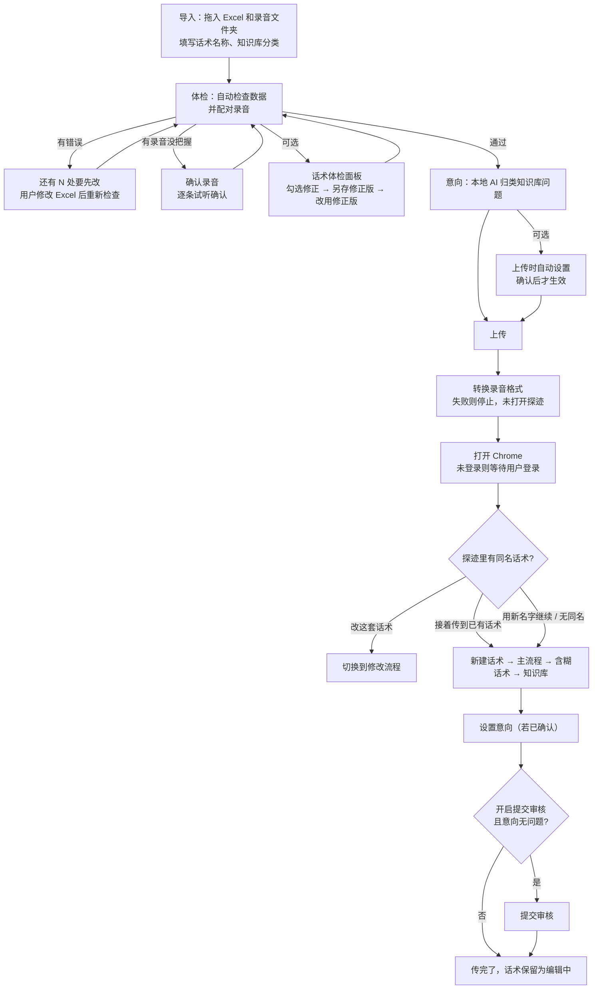
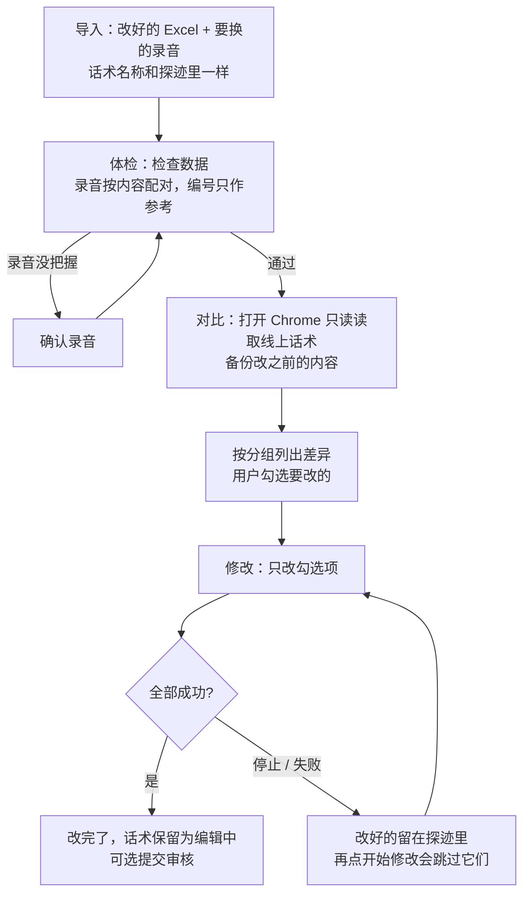
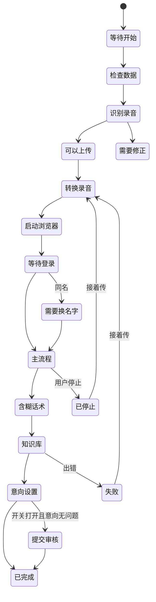

# 探迹话术上传助手 v2.0 产品需求文档（PRD）

## 文档信息

| 项目 | 内容 |
|---|---|
| 产品 | 探迹话术上传助手（Windows / macOS 桌面工具） |
| 文档版本 | v2.0 草稿（待评审） |
| 对应软件版本 | 2.0.0 |
| 编写日期 | 2026-09-29 |
| 产品负责人 / 评审人 | 待确认（见 Q1） |
| 编写依据 | 当前代码（共享服务 `src/main`、Windows 界面 `src/renderer`、Mac 原生界面 `mac/Sources`）、自动化测试用例、v1.0 PRD、v1.1 使用说明、界面截图（`mac/shots`） |

### 标注约定

- **🔶 假设（待确认）**：根据代码或旧文档推断，合理但未经业务确认。
- **🔵 待确认 Qn**：目前不知道答案，需要找人确认。全部问题汇总在第 13 章。
- **⚠️ 需核实**：代码现状和界面文案或产品原则可能对不上，需要人工核实。全部汇总在第 14 章。
- 文中「」里的文字是界面原文，错误码（如 `E-AUDIO-006`）与代码一致。
- 所有样例使用「示例公司」「示例话术」，不出现真实人名或客户公司名。

### 变更记录

| 版本 | 日期 | 说明 |
|---|---|---|
| v1.0 | 早于本文 | 命令行 / 早期桌面版需求：新建话术上传 13 条主流程、4 条含糊话术和知识库 |
| v1.1 | 早于本文 | Windows 安装版与便携版、错误码体系（依据 v1.1 使用说明） |
| v2.0 | 2026-09-29 | 本文：新增「修改已有话术」流程、语音识别配对录音、本地 AI 体检与意向建议、自动设置意向、自动转换录音格式、断点续传、Mac 原生版 |

---

## 目录

0. 一页纸摘要
1. 背景与问题
2. 目标与非目标
3. 目标用户与画像
4. 核心使用场景与用户故事
5. 产品方案总览
6. 功能需求
7. 非功能需求
8. 关键约束、边界情况与错误处理
9. 成功指标
10. 发布与版本范围
11. 依赖
12. 风险
13. 待确认问题
14. 需人工核实的事实
- 附录 A 术语表
- 附录 B 本地数据清单
- 附录 C PRD 自评

---

## 0. 一页纸摘要

**一句话**：我们为在探迹智能呼叫里搭建外呼话术的同事，做了一个本地桌面工具。它读取按标准模板填好的 Excel 话术表和一个录音文件夹，先在本机把数据和录音检查一遍、配对好，再自动打开 Chrome，把话术、录音、QA 标记和意向逐条填进探迹网页。已有的话术也能只改有变化的地方。

**v2.0 的重点**

1. **两条流程**：「新建话术」（导入 → 体检 → 意向 → 上传）和「修改已有话术」（导入 → 体检 → 对比 → 修改）。
2. **录音不用严格命名**：按文件名编号、文件名文字、录音内容（本机语音识别）综合配对，没把握的交给人逐条确认。
3. **本地 AI 帮忙，不联网**：补充常用问法、查错字漏字、建议 QA 标记、把知识库问题归类成意向建议。AI 只给建议，由人决定。
4. **安全**：原始 Excel 和录音从不修改（修正版另存一份、转换后的录音另存）；检查不通过不打开探迹；自动意向要用户确认，只新建不改默认；默认不提交审核。
5. **能续传**：中途停止、浏览器被关、网络中断后，点「接着传」会跳过已完成的部分。

**范围外**：不删除探迹里的任何内容，不修改 Excel 模板结构，不代替人登录，不自动提交审核（除非用户主动打开开关），不联网调用 AI。

---

## 1. 背景与问题

### 1.1 业务背景

在探迹智能呼叫里上线一套「人工录音」外呼话术，需要在网页上完成以下工作：

- **主流程 13 条**：开场白、产品介绍、客户邀约（意向邀约 01–02、挽回邀约 01–05）、结束话语 01–04，每条填文字、上传一条录音。
- **含糊话术 4 条**：客户听不清或答非所问时的兜底话术，同样要文字和录音。
- **知识库若干条**：客户提问时回答。每条要填问题名称、常用问法、回答、录音，还可能要勾选「无效QA」「特殊QA」，并放进某个知识库分类。
- **意向设置**：根据客户问到的问题给通话打 A/B/C/D 级。
- **提交审核**。

一套话术通常有几十条录音（截图示例：57 条录音、41 个知识库问题）。这些内容由业务人员整理在探迹标准 Excel 模板里，录音由人工录制后导出成一个文件夹。

### 1.2 问题陈述

> **我是**负责给客户搭建外呼话术的同事，
> **我想要**把整理好的 Excel 话术和几十条录音准确地放进探迹，
> **但是**网页上要一条一条粘贴文字、找对应的录音文件、上传、等待、保存，还要逐个勾选 QA 标记和配置意向，
> **因为**这些操作重复、步骤多，录音文件名和格式也常常不规范，
> **所以我**要花大量时间，还容易传错录音、漏传内容；上传到一半出问题时不知道传到哪了；话术上线后要改几句，也只能再手动找、手动改。

### 1.3 v1.x 已解决与仍存在的问题

🔶 假设（依据 v1.0 PRD 与 v1.1 使用说明推断）：

| 方面 | v1.x 状态 | v2.0 仍需解决的问题 |
|---|---|---|
| 新建上传 | 已能按 Excel 自动上传主流程、含糊话术、知识库 | — |
| 录音命名 | 要求严格按编号命名（如 `18.wav`） | 录音常常叫「新录音 3」「价格.m4a」，要人工改名 |
| 录音格式 | 需要事先转成探迹要求的格式 | 用户不懂 8k 单声道 WAV，经常传失败 |
| 修改已有话术 | 不支持，只能手动改网页 | 改几句话也要全手工，容易改漏 |
| 意向设置 | 不自动设置 | 每套话术都要手动建意向、挑问题 |
| 数据质量 | 只检查结构 | 常用问法太少、语气词、错字、QA 标记漏设，上线后机器人识别差 |
| 中断恢复 | 有限 | 中断后不知道传到哪，重传会产生重复内容 |

### 1.4 证据

- 代码与测试：音频配对规则（`tests/audio-matching.test.ts`）专门覆盖了「乱序的新录音」「同一句录了两遍」「漏字、错字、口头语」等真实场景，说明这些是实际遇到的问题。
- 话术体检规则（常用问法少于 6 条、语气词、系统提示问法、两个问题抢同一句问法等）说明团队已观察到这些质量问题。
- 🔵 待确认 Q4：缺少量化数据（手工搭建一套话术的耗时、出错率、每月搭建量）。

---

## 2. 目标与非目标

### 2.1 产品目标

| 编号 | 目标 | 说明 |
|---|---|---|
| G1 | 缩短搭建一套话术的时间 | 从手工逐条操作变成「准备文件 → 检查 → 确认 → 自动上传」 |
| G2 | 零误传 | 录音和话术一一对应，没把握的必须人确认；检查不通过不打开探迹 |
| G3 | 提升话术质量 | 上传前发现问法不足、错字、QA 标记遗漏等问题，并能一键修正 |
| G4 | 支持修改已有话术 | 只改有变化的地方，改之前备份，其他内容不动 |
| G5 | 可恢复 | 任何中断后都能接着传，不重复创建 |
| G6 | 数据不出本机 | AI 和语音识别都在本机运行，不联网 |

🔵 待确认 Q5：各目标的量化目标值。

### 2.2 产品原则（已确认，必须遵守）

1. **不改 Excel 模板结构**：只读取探迹标准模板，不要求用户增删列或改表头。
2. **从不修改原始文件**：体检修正另存为新文件（默认名「<原名>-修正版.xlsx」），不允许覆盖原文件；需要转换的录音另存一份，原录音不变。
3. **先检查后执行**：数据检查不通过、录音待确认、录音转换失败时，都在打开探迹之前停下，「此时尚未打开探迹，不会留下草稿」。
4. **AI 给建议，人做判断**：自动意向必须用户确认后才会执行；只新建意向，不改不删默认的 5 条。
5. **AI 运行时不发网络请求**：语音识别和大模型都使用安装包内置的模型文件在本机运行。
6. **界面文案简洁**：用口语短句，例如「文件都齐了」「需要你看一眼」「传完了」。
7. **演示数据和截图不出现真实人名**。
8. **不主动弹出系统权限请求或自动弹窗**（⚠️ 首次启动会自动开始新手引导，见第 14 章 V2）。
9. **以网页状态为准**：续传、修改前都先读取探迹里的实际内容，已存在的跳过。

### 2.3 非目标（v2.0 不做）

- 不删除探迹里的任何话术、问题、分类或意向。修改模式下「探迹里有，表里没有，不会删除」。
- 不修改或删除探迹默认的 5 条意向。
- 不代替用户登录探迹，不保存或读取账号密码（用户在 Chrome 里自己登录）。
- 不自动提交审核（用户打开「完成后提交审核」开关才会提交，默认关闭）。
- 不支持探迹「人工录音」以外的话术类型（如 TTS 合成）。🔶 假设：代码只选择「人工录音」。
- 修改模式不支持：改知识库分类、改问题名称（改名会被当作新增，旧问题不删）、调整主流程卡片数量。
- 不提供录音录制和编辑功能。
- 不提供自动更新、账号体系、使用数据上报。
- 不支持 Intel Mac、32 位或 ARM Windows（仅发布 macOS arm64 和 Windows x64，见 Q12）。

---

## 3. 目标用户与画像

### 3.1 主要画像：话术搭建专员 🔶 假设

| 项目 | 描述 |
|---|---|
| 角色 | 客户成功 / 交付岗位同事，负责把客户的话术搭建到探迹智能呼叫里（代码会自动切换到名称含「客户成功」的企业空间，见 Q2、Q3） |
| 电脑 | Windows 办公电脑为主，部分使用 Apple Silicon Mac；有 Google Chrome |
| 技能 | 熟悉 Excel/WPS 和探迹网页操作；不懂音频格式、不懂技术 |
| 典型工作量 | 一套话术几十条录音、几十个知识库问题；经常要在上线后改几句 |
| 痛点 | 重复劳动、录音对不上、格式不对、中断后不知道传到哪、改话术要全手工 |
| 期望 | 拖进文件 → 工具告诉我哪里有问题 → 我确认 → 自动传完；出错时知道下一步怎么做 |
| 顾虑 | 怕传错、怕把线上话术改坏、怕客户资料外泄、怕探迹登录被挤掉 |

### 3.2 次要画像

- **话术撰写 / 录音人员**（间接用户）：按模板填 Excel、录音。工具的「怎么填？」指南和「下载模板」面向他们。
- **维护人员**：用户遇到错误时，根据错误码和运行日志排查。设置页提供「运行日志 打开」和「写邮件…」反馈入口。

### 3.3 要完成的任务（JTBD）

1. 当我拿到客户的话术表和录音时，我想**尽快知道材料够不够、对不对**，以便不在网页上做无用功。
2. 当录音文件名乱七八糟时，我想**工具帮我听出每条录音对应哪句话术**，以便不用手动改名。
3. 当我准备上传时，我想**工具帮我补齐问法、查出错字、建议 QA 标记**，以便话术上线后识别效果更好。
4. 当知识库问题很多时，我想**工具建议该建哪些意向**，以便不用自己逐个归类。
5. 当我点下上传后，我想**不用守着电脑，出问题也能接着传**。
6. 当客户要改几句话术或换几条录音时，我想**只改变化的部分，并保留改之前的备份**。

---

## 4. 核心使用场景与用户故事

### 4.1 核心场景

| 编号 | 场景 | 流程 |
|---|---|---|
| S1 | 新建一套话术，材料完整、录音按编号命名 | 新建：导入 → 体检（全部自动配对）→ 意向 → 上传 |
| S2 | 新建话术，录音名字随意（如「新录音 3.m4a」） | 体检时语音识别配对，没把握的进入「确认录音」 |
| S3 | 体检发现问法少、有语气词、QA 标记建议 | 在「话术体检」面板勾选修正 → 另存修正版 → 改用修正版 |
| S4 | 上传时发现探迹已有同名话术 | 选择「改这套话术」「接着传到「X」」或「用新名字继续」 |
| S5 | 上传中途停止 / 浏览器被关 / 网络断开 | 下次打开显示「上次传到一半」，点「接着传」跳过已完成部分 |
| S6 | 上线后改几句话术、换几条录音 | 修改：导入改好的 Excel 和新录音 → 体检 → 对比（只读）→ 勾选 → 修改 |

### 4.2 史诗假设

> 我们相信，为话术搭建专员提供「本地检查 + 智能配对 + 自动上传 / 修改」的桌面工具，
> 能让他们把一套话术从准备好材料到进入探迹的时间大幅缩短，并且不出现误传。
> 当我们看到：单套话术搭建耗时下降、误传投诉为 0、修改类工单改用工具完成，就证明这个假设成立。（量化目标见 Q5）

### 4.3 用户故事与验收标准

> 格式：作为……我想要……以便……；验收标准用「假如 / 当 / 那么」描述。更细的功能验收标准见第 6 章。

**US-01 导入文件**
作为话术搭建专员，我想要把 Excel 和录音文件夹拖进窗口，以便快速开始。
- 假如我把一个 `.xlsx` 文件和一个文件夹同时拖进窗口的任意位置，那么两个位置都被填上，并自动开始检查。
- 假如我拖入无法识别的内容，那么提示「无法识别拖入的内容。」和「请拖入 .xlsx 话术表格，或包含录音的文件夹。」（`E-DROP-003`）。

**US-02 知道材料有什么问题**
作为专员，我想要一次看到所有需要处理的问题，以便集中处理。
- 当检查完成，那么标题直接告诉我结论，例如「还有 3 处要先改」「有 2 条录音想请你确认」「57 条录音都就位了」。
- 那么「需要你看一眼」列出每类问题和对应按钮（如「打开文件夹」「去补充」「去看看」）。

**US-03 录音自动配对**
作为专员，我想要工具自动把录音配到话术上，以便不用手动改文件名。
- 假如录音文件名就是编号（`1.wav`…），那么全部自动配对。
- 假如录音名字随意但内容和话术一致（允许漏字、错字、口头语），那么按录音内容自动配对。
- 假如同一句录了两遍、录音太短、两句话术几乎一样，那么进入「确认录音」，由我决定。

**US-04 确认没把握的录音**
作为专员，我想要逐条试听、选择候选录音，以便确保不传错。
- 当我打开「确认录音」，每条显示最多 3 个候选、相似度和识别出的文字，我可以试听；也可以选「这条没有录音 只上传文本」。
- 支持键盘：「↑↓ 选择 · 空格重播 · Enter 确认 · ← 上一条」。
- 当我确认完，那么结果被记住，下次打开同一组文件（包括修正版）不再重复询问。

**US-05 话术体检与一键修正**
作为专员，我想要工具帮我补问法、去语气词、建议 QA 标记，以便提高识别效果。
- 当我勾选修正项并点「另存修正版」，那么选择保存位置后生成新文件，原文件不变；修正版会自动重新检查，通过后显示「已另存并复查通过」，可「改用修正版」。
- 假如我选的保存路径就是原文件，那么拒绝保存并提示不能覆盖原文件（`E-CHECKUP-001`）。

**US-06 意向建议**
作为专员，我想要工具把知识库问题归成意向建议，以便快速配置意向。
- 当进入「意向」页，本地 AI 自动分析，给出「建议新增 N 条意向」及每条包含的问题。
- 我可以把问题点一下换到别的意向或「不建意向」。
- 我可以「复制建议」或「导出…」为 Markdown，自己去探迹配置。

**US-07 自动设置意向（需确认）**
作为专员，我想要上传时顺手把意向建好，但必须经我确认。
- 当我点「上传时自动设置」，弹出确认框「上传时自动设置 N 条意向？」，说明「只新建这些意向，默认的 5 条不改不删；探迹里已有的会跳过。有任何一步失败，就不会自动提交审核。」
- 只有点「自动设置」后，上传流程才会设置意向。

**US-08 自动上传**
作为专员，我想要点一次按钮就全部传完，以便不用守着。
- 当检查通过、录音已确认，点「开始上传」，工具会先转换需要转换的录音，再打开 Chrome；若未登录则提示「在 Chrome 里登录探迹」，我登录后点「已登录，继续」。
- 那么依次上传主流程、含糊话术、知识库，然后设置意向（若已确认），最后按开关决定是否提交审核。
- 默认完成后提示「全部完成，已新建 N 条意向，话术保留为编辑中」（或不含意向的版本）。

**US-09 同名话术处理**
作为专员，我想要在探迹已有同名话术时选择怎么办，以便不产生重复话术。
- 当检测到同名，页面显示「探迹里已有同名话术」，提供「改这套话术」「接着传到「X」」「用新名字继续」（默认建议名「<原名>-2」）。

**US-10 断点续传**
作为专员，我想要中断后接着传，以便不用从头开始。
- 当上次任务中断，页面显示「上次传到一半 「X」已完成 N 条（时间），接着传会跳过它们。」，提供「重新开始」「接着传」。
- 改名话术或改用修正版后，断点仍然有效；换了 Excel 或录音文件夹，断点不适用。

**US-11 对比线上话术（只读）**
作为专员，我想要先看到表格和探迹线上有哪些不同，以便确认要改什么。
- 当点「开始对比」，工具「打开探迹里的「X」，只读不改，找出和表格不一样的地方」，并备份改之前的线上内容。
- 结果按「需要你看一眼 / 文字和录音 / 只换录音 / 只改文字或问法 / 新增 / 表里没有（不处理）」分组，默认勾选可改的项。
- 标点不同不算修改。

**US-12 只改勾选的内容**
作为专员，我想要只改我勾选的内容，以便其他内容保持不动。
- 当点「开始修改」，只修改勾选项；同一条录音不会重复上传；中途停下后再点「开始修改」会跳过已改好的。
- 完成后提示「改好了 N 处，话术保留为编辑中」。

**US-13 学会使用**
作为第一次使用的人，我想要有引导，以便知道怎么用。
- 首次打开自动进入新手引导（演示数据，不动我的文件，Esc 退出）；以后可在「设置 → 关于 → 新手引导 重新看一遍」。
- 每页顶部有「下一步」提示和「指给我看」按钮。
- 「怎么填？」打开「怎么填模板 四步填好」指南。

**US-14 清理空间与反馈**
作为专员，我想要清理工具占用的空间、方便反馈问题。
- 「设置 → 存储空间」列出浏览器缓存、已转换录音、运行日志、软件缓存、探迹登录信息，可勾选后「清理所选」。
- 「反馈与建议 → 写邮件…」打开邮件客户端并打开日志文件夹。

---

## 5. 产品方案总览

### 5.1 界面框架

- **窗口**：默认 1180×760，最小 980×620；单实例运行（再次打开会激活已有窗口）。
- **左侧栏**：当前模式（修改模式时显示「修改已有话术」），四个步骤及状态标签（如「已添加」「已通过」「N 个错误」「N 条待确认」「7 处」），底部「设置」。
- **顶部工具栏**：体检页有「导出报告」；「详细信息」开关右侧进度栏；右上角一个主按钮，文案随状态变化（见 6.0.6）。
- **右侧进度栏**：新建模式显示「录音配对 / 话术体检 / 意向建议 / 上传」，修改模式显示「录音配对 / 话术体检 / 线上对比 / 修改」，下方「运行记录」（保留最近 200 条）。
- **页面顶部**：大标题说结论，副标题说原因或下一步；「下一步」提示条 +「指给我看」。

### 5.2 新建话术流程

### 5.3 修改已有话术流程

### 5.4 上传任务状态

（状态名与界面「等待开始、检查数据、识别录音、可以上传、需要修正、转换录音、启动浏览器、等待登录、读取线上话术、需要换名字、主流程、含糊话术、知识库、意向设置、提交审核、已完成、已停止、失败」一致；修改流程另有「读取线上话术」。）

---

## 6. 功能需求

优先级：P0 = 必须，缺了不能发布；P1 = 应该有；P2 = 可以有。v2.0 代码已实现以下全部功能，优先级用来判断回归测试的重点。🔶 优先级为编写者判断。

### 6.0 通用功能

#### 6.0.1 文件导入（P0）

- 支持两种方式：拖入窗口任意位置，或点「选取…」/「更换…」。
- 话术表格只接受 `.xlsx`；录音文件夹里识别 WAV、MP3、M4A、AAC、FLAC、OGG。
- 更换任一文件后，之前的检查结果和意向建议清空，重新检查。

**验收标准**
- 同时拖入 Excel 和文件夹，两个位置都被填上。
- 拖入其他内容显示 `E-DROP-003`。
- 选中的文件或文件夹被删除 / 移动后再检查，显示 `E-FILE-001`「选中的文件或文件夹已不存在。」。

#### 6.0.2 模板与填写指南（P1）

- 「下载模板」（仅新建模式）：把内置的探迹标准模板另存到用户选择的位置。
- 「怎么填？」打开「怎么填模板 四步填好 · Excel、WPS 里操作都一样」：
  1. **打开工作表**：在「话术内容」表里填，不要增删列、改表头。
  2. **主流程**：第 3–15 行是主流程，第 18–21 行是含糊话术，把话术粘到 E 列「客户话术填写列」；录音编号 1 对应 `1.wav`。
  3. **知识库**：从第 25 行开始，A–E 列依次是问题、问法、回答示例、编号、客户话术填写列；编号从 18 开始连续编。
  4. **无效QA / 特殊QA**：F、G 列需要时填「是」。

**验收标准**：指南示例使用「示例公司」；下载的模板和内置模板一致。

#### 6.0.3 新手引导与「下一步」提示（P1）

- **新手引导**：首次启动自动开始（约 24 步，覆盖导入、体检、意向、上传四页），使用演示数据，不读写用户文件；Esc 退出；完成后不再自动出现（Windows 用本地存储、Mac 用系统偏好保存「已看过」）；可在设置里「重新看一遍」。⚠️ 与「不自动弹窗」原则的关系见 V2。
- **「下一步」提示**：每页顶部显示当前最该做的一件事，并提供操作按钮（「帮我选取」「帮我定位」「帮我检查」「帮我打开」「打开表格」「帮我设置」「重新分析」「帮我开始」「带我过去」「帮我继续」）或「指给我看」；可跳过的步骤标注「可以跳过」。

#### 6.0.4 设置（P1）

- **存储空间**：浏览器缓存、已转换录音、运行日志、软件缓存、探迹登录信息，显示占用大小，勾选后「清理所选」。
  - 上传任务运行中不能清理浏览器缓存和登录信息：`E-STORAGE-001`。
  - 文件被占用等情况：`E-STORAGE-002`「清理缓存时遇到问题。」。
  - 清理「探迹登录信息」后，下次上传需要重新在 Chrome 里登录。
- **关于**：新手引导「重新看一遍」、运行日志「打开」、版本号。
- **反馈与建议**：「写邮件…」打开邮件客户端并打开日志文件夹，方便附上日志。🔵 反馈邮箱见 Q19。

#### 6.0.5 导出数据检查报告（P1）

- 体检页工具栏「导出报告」，默认保存到「下载」文件夹，文件名「<话术名称>-数据检查报告.xlsx」。
- 报告包含 4 个工作表：概览、问题明细、识别预览、话术体检。

#### 6.0.6 主按钮文案

| 状态 | 主按钮 |
|---|---|
| 未检查 / 检查中 | 检查数据 / 检查中… |
| 有录音待确认 | 确认录音（N） |
| 有错误 | 重新检查 |
| 新建模式体检通过 | 下一步：意向 |
| 意向页 | 下一步：上传 |
| 上传页（未开始 / 中断 / 完成） | 开始上传 / 接着传 / 再传一次 |
| 修改模式体检通过 | 下一步：对比 |
| 对比页（未开始 / 完成） | 开始对比 / 下一步：修改 / 再对比一次 |
| 修改页 | 开始修改 |
| 任务运行中 | 停止 |

### 6.1 新建话术流程

#### F-C1 导入（P0）

**页面**：顶部分段切换「新建话术 / 修改已有话术」。

| 状态 | 标题 |
|---|---|
| 都没选 | 从两份文件开始 |
| 缺表格 | 还差话术表格 |
| 缺录音 | 还差录音文件夹 |
| 都齐了 | 文件都齐了 |

副标题：「把 Excel 话术表和录音文件夹拖进窗口，或者点下面选取。」

**字段**

| 字段 | 规则 | 默认值 |
|---|---|---|
| 话术表格 | 提示「探迹标准模板 .xlsx」；按钮「下载模板」「怎么填？」「选取…/更换…」 | 空 |
| 录音文件夹 | 提示「WAV、MP3、M4A 都可以」；选好后显示「N 个录音」 | 空 |
| 话术名称 | 1–19 个字符（「少于20个字符」），输入框最多 19 字 | 🔶 由表格推断或留空（未核实） |
| 知识库分类 | 1–9 个字符（「少于10个字符」） | 客户问答 |

**验收标准**
- 话术名称为空或超过 19 字时不能开始，后台校验提示「话术名称不能为空且必须少于20个字符」。
- 知识库分类为空或超过 9 字时不能开始，提示「知识库分类名称不能为空且必须少于10个字符」。
- 两份文件都选好后自动进入检查。

#### F-C2 体检（P0）

##### F-C2.1 数据检查

**读取规则**
- 自动选工作表：优先选含「话术内容」表头的工作表，否则给出提醒 `W-SHEET-001`。
- 表头别名：问题（问题 / 问题名称…）、问法（问法 / 常用问法…）、录音编号（录音编号 / 编号…）、回答（客户话术填写列 / 回答…）、无效QA、特殊QA。
- 主流程固定 13 条，顺序和录音编号固定为：开场白(1)、产品介绍(2)、客户邀约-意向邀约01–02(3–4)、客户邀约-挽回邀约01–05(5–9)、结束话语01–04(10–13)。
- 含糊话术固定 4 条：含糊话术01–04，录音编号 14–17。
- 知识库：每行必须有问题、问法、回答和正整数编号；问题名称不能重复。
- QA 标记接受：是 / 否 / 1 / 0 / √ / × / yes / no / 空；模板没有无效QA / 特殊QA 列时按「否」处理（`W-QA-001`）。

**错误（阻止上传）**：`E-FLOW-001/002`、`E-VAGUE-001/002`、`E-AUDIO-001/002/004`、`E-ROW-001`、`E-SECTION-001`、`E-TEXT-001`、`E-COLUMN-003/004`、`E-QA-002/003/004/005`（详见 8.3）。

**提醒（不阻止）**：`W-AUDIO-001` 缺录音（修改模式不提示）、`W-AUDIO-002` 录音无法识别、`W-QA-001`、`W-SHEET-001`。

**页面标题**

| 结果 | 标题 |
|---|---|
| 有错误 | 还有 N 处要先改 |
| 有录音待确认 | 有 N 条录音想请你确认 |
| 通过 | N 条录音都就位了 |
| 缺部分录音 | 副标题：全是主流程/含糊话术时「还差 X 号的录音，这几条会只上传文字。」；全是知识库问题时「……这几条知识库问题不会上传。」；两者都有时「……缺录音的知识库问题不会上传，其余只传文字。」 |

**验收标准**
- 结构错误逐条列出，含行号、字段和修改建议。
- 修改 Excel 后点「重新检查」能刷新结果。
- 检查只读取文件，不写入原文件。

##### F-C2.2 录音配对（P0）

**配对依据**（按可信度）：
1. 已确认：用户之前确认过的结果优先，不再询问。
2. 编号：文件名就是编号，如 `18.wav`。
3. 文件名含编号：如「编号18」「18_xxx」。
4. 文件名文字：文件名接近模块名（如「开场白.m4a」）。
5. 录音内容：本机语音识别出文字后和话术比较相似度，允许漏字、错字、口头语。
6. 录音顺序：只在无法语音识别、且文件是「新录音 3」这类自动命名时，按顺序给建议。

**规则**
- 整体做最优分配，保证一条录音只配一句话术。
- 已被编号覆盖的录音不再做语音识别，节省时间。
- 语音识别结果按文件大小和修改时间缓存，文件没变就不重新识别。
- 语音识别不可用时，提示「这次只按文件名配对」。

**需要人确认的情况**（原文）：「录音很短，无法可靠判断」「两条录音都像这句，可能是重录」「文件名和话术接近，但不够确定」「和话术差别较大，可能没照稿念」「和第 N 号话术几乎一样」「文件名是 N 号，但听起来像这句」「同一编号有 N 个文件，可能是重录」「只能按录音顺序推断」「没有找到对应录音」。

**验收标准**（对应自动化测试）
- 文件名就是编号时全部自动配对。
- 乱序的新录音按语音内容自动配对。
- 同一句录了两遍、同一编号有多个文件、录音很短、两句话术几乎一样时需要确认。
- 有剩余文件时，没配上的话术进入确认；没有剩余文件时，缺录音不打扰用户。
- 已确认的结果优先且不再询问。

##### F-C2.3 话术结构图（P1）

- 显示「话术结构」：主流程（开场白 > 产品介绍 > 客户邀约 > 结束话语）、含糊话术（「听不清或答非所问时兜底」）、知识库（「客户提问时回答」），每条录音一个圆点。
- 圆点状态：已配对、会转格式、缺录音、没把握、等待、正在传、已上传。
- 鼠标悬停约 0.3 秒显示简要卡片；点击展开详情卡片（可试听、看配对依据），Esc 或点外面关闭。

##### F-C2.4 确认录音面板（P0）

- 标签页：逐条确认 / 需要看 N / 没录音 N / 全部 N。
- 逐条确认：每条显示最多 3 个候选录音，含配对依据、相似度百分比、识别文字、试听；可选「这条没有录音 只上传文本」。
- 按钮：「上一条」「剩下的都用推荐」「确认，下一条」/「确认完成」。
- 键盘：↑↓ 选择 · 空格重播 · Enter 确认 · ← 上一条。
- 列表模式：每行下拉改选，「保存修改」。
- 显示「没用上的文件不会上传：…」。
- 确认结果按「Excel + 录音文件夹」保存；另存修正版后自动沿用到修正版，但不覆盖修正版自己的确认。

##### F-C2.5 「需要你看一眼」列表（P0）

列表最多显示 8 行，其余显示「还有 N 条」。可能出现的行：

| 行 | 按钮 / 说明 |
|---|---|
| 数据错误 | 逐条显示 |
| N 条录音没把握 | 逐条确认 |
| X 号没有找到录音 | 打开文件夹；主流程/含糊话术写「文字照常上传，补上录音后重新检查即可」，知识库问题写「知识库问题没有录音不会上传，补上录音后重新检查即可」 |
| N 个问题问法偏少，AI 可以帮你补 | 去补充（少于 6 条） |
| N 条特殊QA的话术是问句 | 去看看 |
| 有 N 条 QA 设置建议 | 去看看 |
| 有 N 处可以一键修好 | 「修好的表格另存一份，原文件不动」 |
| 话术里有 N 处值得留意 | 去看看 |
| 这次只按文件名配对 | 语音识别不可用时出现 |
| N 个录音会先转格式 | 「上传前转成探迹要求的 8k 单声道 WAV，原文件不变。」 |
| 录音和话术的对应关系 | 已自动配对 X/Y |

##### F-C2.6 话术体检面板（P1）

标题「话术体检」，说明「N 项 · 修正会另存为新文件，原文件不变」。

| 标签页 | 内容 | 默认 |
|---|---|---|
| 需选择 | 两个问题抢同一句问法：选保留在哪个问题，或「不处理」 | 未选择 |
| 补问法 | 问法少于 6 条的问题，AI 自动生成候选问法；6–9 条的也提供候选 | 少于 6 条的预先勾选；6–9 条的不勾选；可「全选」「换一批」 |
| QA 设置 | 结尾是道别语（如「再见」「拜拜」「不打扰您了」）的建议设为特殊QA；机器人 / 号码哪来 / 打错 / 听不清 / 骚扰投诉 / 你是谁 / 道别 / 系统提示类问题建议设为无效QA；特殊QA 回答以问句结尾时提醒 | 特殊QA 建议默认勾选；无效QA 建议默认不勾选 |
| 自动修正 | 系统提示问法换成最新完整版、去掉语气词、合并重复问法、拆分符号粘连的问法 | 全部勾选 |
| 提醒 | AI 查错字漏字（「在本机运行，约 1–3 分钟」，需点「开始检查」，可「取消」）；超过约 90 字的长话术（约 4 字/秒）等提示 | — |

**补问法规则**：每条候选 4–10 字、客户口吻；过滤销售口吻；AI 二次复核不合适的去掉；追加到末尾，单条问法不超过 40 字，每行最多补 20 条，已属于其他问题的问法不补。

**另存修正版**
- 底部显示「已选 N 项」，按钮「关闭」「另存修正版」。
- 保存对话框默认名「<原名>-修正版.xlsx」；不能选原文件路径。
- 只改问法列和 QA 标记单元格（写入「是」），其他单元格、公式、格式、列顺序保持不变；遇到公式单元格拒绝修改。
- 保存前先在临时副本上重新检查，通过才写入目标位置。
- 成功后显示「已另存并复查通过」，按钮「改用修正版」；改用后断点和录音确认结果都沿用。

**验收标准**
- 原文件的修改时间和内容不变。
- 未选择任何项：`E-CHECKUP-003`「没有需要修正的内容。」。
- 修正版结构和原文件不一致：`E-CHECKUP-002`，取消保存。
- 本地 AI 不可用：`E-AI-001`「本地 AI 暂时用不了：…」「其他功能不受影响。…」，规则类修正仍可用。

**上传时的自动整理**（不改 Excel）：上传问法前自动去掉语气词、合并重复、系统提示问法换成最新完整版。

#### F-C3 意向（P1）

**触发**：体检通过后进入「意向」页，自动开始分析；没有知识库问题时显示「这套话术不用设置意向」。

**分析方法**
1. 标准问题查内置参考表（如「价格介绍」→ 询价、「给我发资料/短信/邮件」→ 要行动）。
2. 其他问题交给本地 AI 归类（结合开场白、产品介绍理解业务）。
3. AI 不可用时按关键词粗分，全部标为需确认，并提示「本地 AI 没启动，这次按关键词归类：…」。
4. 无效QA 问题不参与。结果缓存，同样的问题不重复分析。

**建议卡片**（最多 6 条）

| 等级 | 卡片 | 规则 |
|---|---|---|
| A级 | 要联系方式 / 资料 / 面谈 / 演示 | 明确行动类问题 |
| A级 | 主动询价 | 询价类问题单独一张 |
| B级 | 业务咨询 / 合作评估 | 至少 2 个咨询类问题才建 |
| C级 | 价格异议 / 已有合作 / 没预算 | 放在最后；与默认「C级｜在忙/考虑」重复的不建 |

默认 5 条意向（不改不删）：D级｜无意向、A级｜同意邀约、B级｜主流程命中肯定、C级｜在忙/考虑、C级｜通话时长>40秒且对话轮次>2。

**页面**

| 状态 | 标题 |
|---|---|
| 分析中 | 正在读懂客户会问什么 |
| 有建议 | 建议新增 N 条意向（副标题「默认的 5 条意向保持不动。觉得哪个问题放错了，点一下换过去。」） |
| 无需新增 | 默认意向已经够用 |
| 失败 | 意向建议没生成 |

- 说明行：「N 个知识库问题 · 本地 AI 归类，不联网」。
- 每个问题是一个标签，可移到「A级｜明确行动 / A级｜主动询价 / B级｜业务咨询 / C级｜暂缓或异议 / 不建意向」；AI 没把握的标签带标记。
- 操作：「上传时自动设置」「复制建议」「导出…」（Markdown，「<话术名称>-意向设置建议.md」）「重新分析」。
- 确认后若又调整问题，提示「你刚调整过问题，自动设置还是之前的版本。」，按钮「更新」/「不自动设置」。
- 上传页「上传设置」里显示「传完后自动新建 N 条」或「不自动设置」，可「去设置」。

**验收标准**（对应测试）
- 询价单独 A 级、太贵归 C 级、在忙考虑不重复、身份确认类不建。
- 只有一个业务咨询问题时不建 B 级；用户移动后重新组卡。
- 转成网页设置后，A/B 级排在「主流程命中肯定」之前，C 级排最后，描述不超过 19 字。
- 未经确认，上传不会设置任何意向。

#### F-C4 上传（P0）

##### F-C4.1 上传前准备

1. 重新读取数据：有错误则停止（`E-DATA-002`）；有录音待确认则停止（`E-AUDIO-006`「还有 N 条录音需要确认，已停止上传。」）。
2. 转换录音：不是 8k / 单声道 / 16 位 PCM WAV，或文件名编号与行号不一致的，转换后另存到录音文件夹下的「已转换-8k」子文件夹，命名为「编号.wav」。任一失败则停止（`E-AUDIO-005`）。
3. 以上都在打开探迹之前完成，失败时「此时尚未打开探迹，不会留下草稿」。

##### F-C4.2 打开浏览器与登录

- 使用电脑上已安装的 Google Chrome，以本工具专用的用户资料目录打开（不影响用户日常使用的 Chrome 资料）。
- 自动恢复上次保存的探迹登录状态；已登录则直接继续。
- 未登录则显示「在 Chrome 里登录探迹」，用户在 Chrome 中完成登录后点「已登录，继续」。
- 进入探迹智能呼叫，并切换到名称含「客户成功」的企业空间（🔵 Q3）。
- 工具不读取、不保存账号密码。

##### F-C4.3 同名话术处理

- 创建前检测探迹「我的话术」里是否已有同名话术。
- 有同名时进入「换个话术名称」状态，显示「探迹里已有同名话术」和三个选项：
  - **改这套话术**：切换到修改流程，并自动开始对比。
  - **接着传到「X」**：继续往已有话术里传，逐条检查已存在的内容并跳过。
  - **用新名字继续**：默认填「<原名>-2」，可修改。

##### F-C4.4 逐条上传

顺序：主流程 → 含糊话术 → 知识库 → 意向 → 提交审核（可选）。

- **主流程 / 含糊话术**：在对应卡片「话术01：」编辑文字并保存，再上传录音，等到页面显示文件名和「重新上传」按钮才算完成。缺录音的只保存文字，运行记录显示「…缺少 N.wav，已保存文本并跳过录音」。
- **知识库**：分类不存在则「新建分类」；逐条新建问题，填名称、回答、常用问法（已自动整理），按表格勾选无效QA / 特殊QA，上传录音后保存。没有配到录音的知识库问题不上传（已定，界面文案同步说明）。
- 每完成一条立即记录断点。
- 右侧进度和结构图圆点实时变化（等待 → 正在传 → 已上传）；标题「正在上传 x/N」。

##### F-C4.5 设置意向（仅当用户已确认）

- 进入话术设置 → 意向设置，逐条「新建意向」：选等级，填描述（≤19 字），开启「参与意向率计算」，条件为「命中特定问题名称」，选择对应问题。
- 描述相同的已有意向跳过；A/B 级上移到「主流程命中肯定」之前，C 级放最后。
- 完成后刷新页面，核对等级和问题是否正确。
- 有问题（例如问题不在探迹知识库里）时记入报告，并**暂停提交审核**。

##### F-C4.6 提交审核

- 「完成后提交审核」开关默认关闭。
- 仅在开关打开且意向设置没有问题时点击「提交审核」；提交审核阶段不能停止。

##### F-C4.7 完成、停止与续传

| 情况 | 提示 |
|---|---|
| 完成（未提交） | 全部完成，已新建 N 条意向，话术保留为编辑中 |
| 完成（已提交） | …已点击提交审核 |
| 意向有问题 | 话术已上传，意向设置有 N 处需要处理…已暂停提交审核 |
| 用户停止 | 已经停下：「已传的内容留在探迹里，点“接着传”会跳过它们。」 |
| 浏览器被关 | `E-BROWSER-002`：「已传的部分都记下了，点“接着传”会重新打开 Chrome，找到这套话术继续。」 |
| 下次打开 | 上次传到一半：「「X」已完成 N 条（时间），接着传会跳过它们。」按钮「重新开始」「接着传」 |

- 断点按「Excel + 录音文件夹 + 知识库分类」识别，与话术名称无关；改用修正版后继续有效。
- 续传时在「我的话术」搜索话术名称打开；找不到则 `E-RESUME-001`。
- 停止时保存登录状态并关闭浏览器。

**验收标准**
- 同一条内容不会被创建两次（断点 + 网页存在性检查）。
- 检查未通过、录音待确认、转换失败时，Chrome 不会被打开。
- 提交审核开关关闭时，任何情况下都不会提交审核。
- 上传设置面板可修改话术名称、知识库分类、意向和提交审核开关。

### 6.2 修改已有话术流程

入口：导入页切换「修改已有话术」；Mac 菜单「修改已有话术…」（⇧⌘N）；或上传时遇到同名选「改这套话术」。

#### F-M1 导入（P0）

- 标题「修改一套已有话术」，副标题「拖入改好的 Excel 和要换的录音，只改有变化的地方。」
- 录音文件夹改为「要换的录音」，提示「只放改过的，名字随意」。
- 话术名称提示「和探迹里的名字一样」；不显示「知识库分类」和「下载模板」。

#### F-M2 体检（P0）

与新建流程相同的数据检查，区别：
- 录音名字不可信：编号只作参考，所有录音都做语音识别。
- 文件名写 1 但内容像价格，不按编号替换，交给人确认。
- 没有语音识别时不按录音顺序猜。
- 没有新录音的行不需要确认，也不提示缺录音。
- 标题「N 条新录音都配好了」或「表格检查通过」。
- 结构图图例改为「有新录音 / 会转格式 / 不换录音」。

#### F-M3 对比（P0）

- 点「开始对比」后打开 Chrome，**只读**：只切换标签、悬停查看、打开「编辑问题」后点「取 消」，不保存任何修改。
- 读取完成后把线上内容备份到本机（`modify-backups/<话术名>-<时间>.json`）。

| 状态 | 标题 |
|---|---|
| 未登录 | 请在 Chrome 里登录探迹 |
| 进行中 | 正在和线上对比 |
| 未开始 | 和线上对比（副标题「打开探迹里的「X」，只读不改，找出和表格不一样的地方。」） |
| 失败 | 对比没有完成（`E-MODIFY-002`，「处理好后再点“开始对比”。」） |
| 一致 | 线上和表格一致 |
| 有差异 | 改 N 处，换 M 条录音（副标题「改之前的线上内容已备份。勾选要改的，再点右上角“下一步：修改”。」） |

**比对规则**
- 主流程、含糊话术按卡片位置对应；知识库按问题名称对应。
- 文字比较忽略标点；问法按去掉语气词后的内容逐条比较。
- 状态：有变化、新增、仅线上有、相同、无法修改。

**分组**：需要你看一眼 / 文字和录音 / 只换录音 / 只改文字或问法 / 新增 / 表里没有（不处理，默认折叠）。另显示「N 个录音没配上 …不会上传」。

**提醒原文**
- 「探迹里的X没有第 N 张卡片，这条改不了」
- 「文字改了，但没有新录音，线上还是旧录音」
- 「这条录音念的像修改前的文字」
- 「回答改了，但没有新录音…」
- 「可能是「X」改了名字；加上后旧问题不会删」
- 「新问题要有录音才能加，这次没有配到录音」（无法修改）
- 「上次已经改过」
- 「探迹里有，表里没有，不会删除」

**验收标准**（对应测试）
- 只列出有变化的，标点不同不算改。
- 新问题没有录音不加；录音念的是旧文字要提醒。
- 对比前后线上话术无任何变化。

#### F-M4 修改（P0）

- 标题：「准备修改 N 处」「正在修改 x/N」「改完了」「修改没有完成」「已经停下」（「改好的留在探迹里，再点“开始修改”会跳过它们。」）。
- 副标题：「只改勾选的这些，其他内容不动。」
- 「修改设置」面板：改之前的备份「打开」；「完成后提交审核」开关（提示「建议先在探迹里检查一遍，再手动提交。」）。

**规则**
- 必须先完成与当前文件一致的对比，否则 `E-MODIFY-001`「还没有和线上对比。」。
- 只修改勾选项。
- 录音按内容指纹记录，同一条录音不会重复上传；上传后等待探迹返回成功。
- 每改好一项记录进度，停止后再修改会跳过已完成项。
- 新增问题放入已有分类：优先使用名为「客户问答」的分类，线上没有则放入第一个分类（🔵 Q16）。
- 完成提示「改好了 N 处，话术保留为编辑中」。

**验收标准**
- 未勾选的项在线上保持不变。
- 线上多出的内容不删除。
- 中途停止再继续，不重复修改、不重复上传同一录音。

---

## 7. 非功能需求

### 7.1 本地 AI 与离线

| 能力 | 实现 | 要求 |
|---|---|---|
| 语音识别 | sherpa-onnx 离线识别（Paraformer int8 模型约 82MB + 静音检测模型），CPU 2 线程 | 不联网；模型缺失时提示「缺少语音模型文件：…」，退回按文件名配对 |
| 大模型 | node-llama-cpp 运行 Qwen3-4B-Instruct Q4_K_M（约 2.5GB），上下文 4096，结构化 JSON 输出 | 不联网（禁止运行时下载或编译）；自动使用 GPU；空闲 3 分钟释放内存 |
| 不可用时 | 模型缺失或内存不足 | `E-AI-001`，其他功能不受影响；意向按关键词归类 |

- 工具本身不发起网络请求；唯一的联网行为是通过 Chrome 访问探迹网页（call.tungee.com、user.tungee.com）。代码中未发现使用数据上报。
- 最低内存：⚠️ 代码按总内存 6GB 判断，提示文案写「电脑内存不足 8GB，本地 AI 无法运行」（见 V5）。

### 7.2 数据安全与隐私

- 话术文字、录音、识别结果、AI 分析结果都只保存在本机。
- 不保存账号密码；只保存探迹网站的登录状态（Chrome 专用资料目录 + 登录状态文件），用户可在设置中清除。🔵 登录状态文件是否需要加密见 Q20。
- 修改前的线上内容备份在本机用户数据目录。
- 播放录音只允许访问已预览过的录音文件夹。
- Windows 界面进程开启上下文隔离和沙箱，只通过固定接口和后台通信。
- 本地数据清单见附录 B。

### 7.3 原文件不改

- Excel：只读；修正版必须另存到不同路径，写入前在临时副本上复查。
- 录音：只读；转换结果写入录音文件夹下的「已转换-8k」子文件夹（⚠️ 见 V3）。
- 断点、录音确认结果、识别缓存都存在软件数据目录，不写入用户文件。

### 7.4 性能与资源

| 项目 | 要求 / 现状 |
|---|---|
| 数据检查 | 🔶 几秒内完成（不含首次语音识别） |
| 语音识别 | 只识别没被编号覆盖的录音；结果缓存 |
| AI 查错字 | 「约 1–3 分钟」，可取消 |
| 意向分析 | 可取消；结果缓存 |
| 录音转换 | 单条超时 120 秒 |
| 网页等待 | 页面操作超时约 60 秒；超时报 `E-WEB-001` |
| 安装包 | Mac zip 约 2.6GB、Windows zip 约 2.7GB（含模型） |
| 内存 | 大模型运行时需较大内存，空闲 3 分钟释放 |

### 7.5 可靠性

- 同一时间只能运行一个任务（`E-TASK-001`）。
- 断点续传、修改进度、录音指纹保证中断后不重复创建或重复上传。
- 续传时以网页实际内容为准（检查问题是否已存在）。
- 启动失败有独立错误码（`E-STARTUP-001`～`005`）并写启动日志。

### 7.6 平台差异

| 项目 | Windows | macOS |
|---|---|---|
| 界面技术 | Electron（React） | 原生 SwiftUI，后台运行内置 Node 服务（与 Windows 共用业务逻辑） |
| 系统要求 | Windows x64（🔵 最低版本未知，Q12） | macOS 14.0 及以上，Apple Silicon（arm64） |
| 发布形式 | 免安装 zip：`Tungee-Uploader-2.0.0-Windows-x64.zip`，程序名「探迹话术上传助手」 | zip：`Tungee-Uploader-2.0.0-macOS-arm64.zip` |
| 签名 | 未签名，普通用户权限运行 | 临时签名（未公证） |
| 首次打开 | 可能出现 SmartScreen 提示 | 可能出现 Gatekeeper 提示 |
| 录音解码 | Chromium 内置解码（隐藏窗口） | 系统 afconvert |
| 大模型加速 | 自动选择 GPU / CPU | Metal |
| 快捷键 | — | 新建话术 ⌘N；修改已有话术… ⇧⌘N |
| 录音详情卡片动画 | 🔶 未核实 | 「神灯」展开动画（Metal 着色器） |
| 日志位置 | `%LOCALAPPDATA%\TungeeUploader\logs\startup.log` 等 | `~/Library/Logs/tungee-uploader-desktop/`（含 startup.log、sidecar-stderr.log） |
| 用户数据 | 系统用户数据目录下 `tungee-uploader-desktop` 🔶 | `~/Library/Application Support/tungee-uploader-desktop` |

两端的页面、步骤、文案、规则保持一致。

### 7.7 可用性与文案

- 标题先说结论，副标题说原因或下一步。
- 每个错误包含：错误码、一句话说明、下一步建议；技术详情可展开。
- 支持浅色 / 深色外观。
- 不在用户没操作时弹出系统权限请求。

### 7.8 可维护性

- 错误码按类别分组（见 8.3）。
- 运行记录在界面右侧显示，运行日志保存在本机。
- 页面结构变化时报 `E-PAGE-001` / `E-PAGE-002`，引导用户截图给维护人员。

---

## 8. 关键约束、边界情况与错误处理

### 8.1 业务规则与数据约束

| 约束 | 值 |
|---|---|
| 话术名称 | 1–19 字 |
| 知识库分类名称 | 1–9 字 |
| 主流程 | 固定 13 条，录音编号 1–13 |
| 含糊话术 | 固定 4 条，录音编号 14–17 |
| 知识库编号 | 正整数且不重复（指南建议从 18 连续编） |
| 录音格式（输入） | WAV、MP3、M4A、AAC、FLAC、OGG |
| 录音格式（上传） | 8k 单声道 16 位 PCM WAV |
| 问法偏少 / 较少 | 少于 6 条 / 少于 10 条 |
| 长话术提醒 | 超过约 90 字 |
| 补充问法 | 单条 4–10 字；单元格内单条 ≤40 字；每行最多补 20 条 |
| 新建意向 | 最多 6 条；描述 ≤19 字 |
| 探迹网页限制（输入框提示） | 知识库问题名称「20个字以内」、回答最多 200 字（🔵 工具是否需要提前校验见 Q14） |

### 8.2 边界情况

| 情况 | 处理 |
|---|---|
| 录音比话术多 | 没用上的文件不上传，并列出 |
| 某条话术没有录音 | 主流程 / 含糊话术只传文字；知识库问题整条不上传，体检页、确认录音面板、圆点详情、新手引导都明确写出 |
| 同一句录了两遍 | 进入确认 |
| 同一编号有多个文件 | 进入确认 |
| 录音很短 | 进入确认 |
| 两句话术几乎一样 | 进入确认 |
| 录音无法解码 | `W-AUDIO-002` 提醒；上传前转换失败则 `E-AUDIO-005` 停止 |
| 语音识别不可用 | 只按文件名配对，并提示 |
| 本地 AI 不可用 | `E-AI-001`；规则类体检照常；意向按关键词归类 |
| Excel 单元格是公式 | 修正版不修改该单元格，报 `E-CHECKUP-001` |
| 修正版另存路径与原文件相同 | 拒绝（`E-CHECKUP-001`） |
| 探迹已有同名话术 | 三选一（改这套 / 接着传 / 新名字） |
| 用户关闭了浏览器 | `E-BROWSER-002`，可接着传 |
| 之前的 Chrome 窗口未关 | `E-BROWSER-003`，请关闭后重试 |
| 电脑没装 Chrome | `E-BROWSER-001` |
| 未登录 / 登录失效 | 等待用户登录；未进入话术页 `E-LOGIN-001` |
| 网络断开 | `E-NET-001` |
| 续传时话术被改名或删除 | `E-RESUME-001`，可「重新开始」 |
| 页面改版 / 缩放 | `E-PAGE-001` / `E-PAGE-002` |
| 任务运行中再次开始 | `E-TASK-001` |
| 任务运行中清理浏览器数据 | `E-STORAGE-001` |
| 意向引用的问题不在探迹知识库里 | 记为意向问题，暂停提交审核 |
| 修改模式：线上卡片数少于表格 | 该条标为无法修改 |
| 修改模式：新问题没有录音 | 不新增，提示 |
| 修改模式：问题改名 | 按新增处理，旧问题不删，并提醒 |
| 修改模式：只改了文字没换录音 | 提醒「线上还是旧录音」 |
| 断点只保留最近一组文件 | 🔶 换另一组文件开始上传会覆盖旧断点（Q18） |

### 8.3 错误码清单

| 错误码 | 说明（界面原文） | 何时出现 / 建议 |
|---|---|---|
| E-STARTUP-001～005 | 桌面程序发生未处理错误 / 启动过程异常 / 界面文件加载失败 / 界面进程意外退出 / Electron 初始化失败 | 启动阶段；写启动日志 |
| E-APP-001 | 后台服务通信失败。 | 重开工具 |
| E-DROP-003 | 无法识别拖入的内容。 | 拖入 .xlsx 或录音文件夹 |
| E-CONFIG-001 | 任务参数不完整或格式不正确。 | 话术名称 / 分类不合规 |
| E-FILE-001 | 选中的文件或文件夹已不存在。 | 重新选择 |
| E-DATA-001 | Excel 内容格式不符合要求。 | 按模板检查 |
| E-DATA-002 | Excel 数据检查未通过，已停止上传。 | 未打开探迹 |
| E-FLOW-001 / 002 | 主流程必须固定为 13 条 / 第 N 条应为“X” | 数据检查 |
| E-VAGUE-001 / 002 | 含糊话术必须固定为 4 条 / 第 N 条应为“X” | 数据检查 |
| E-ROW-001 | 流程话术缺少模块名称。 | 数据检查 |
| E-SECTION-001 | 无法识别流程模块“X”。 | 数据检查 |
| E-TEXT-001 | 回答话术为空。 | 数据检查 |
| E-COLUMN-003 / 004 | 未找到知识库表头。/ 检测到多个知识库表头… | 数据检查 |
| E-QA-002 / 003 / 004 / 005 | 问题名称为空 / 缺少常用问法 / QA 标注无法识别 / 问题重复 | 数据检查 |
| E-AUDIO-001 | 录音编号为空或不是正整数。 | 数据检查 |
| E-AUDIO-002 | 录音编号 N 被重复使用。 | 数据检查 |
| E-AUDIO-004 | “X”的录音编号应为 N。 | 数据检查 |
| E-AUDIO-005 | N 个录音无法转换，已停止上传。 | 未打开探迹 |
| E-AUDIO-006 | 还有 N 条录音需要确认，已停止上传。 | 未打开探迹 |
| W-AUDIO-001 / 002 | 缺录音 / 录音无法识别 | 提醒 |
| W-QA-001 / W-SHEET-001 | 缺 QA 列按否 / 未找到「话术内容」表 | 提醒 |
| E-CHECKUP-001 | 不能覆盖原文件 / 没有问法列 / 公式单元格等 | 另存修正版 |
| E-CHECKUP-002 | 修正版没有通过重新检查，已取消保存 | 另存修正版 |
| E-CHECKUP-003 | 没有需要修正的内容。 | 另存修正版 |
| E-AI-001 | 本地 AI 暂时用不了：… | 其他功能不受影响 |
| E-BROWSER-001 | 无法启动 Chrome。 | 安装 Google Chrome |
| E-BROWSER-002 | 浏览器窗口已被关闭。 | 接着传 |
| E-BROWSER-003 | 浏览器会话启动失败。 | 关闭旧 Chrome 窗口 |
| E-LOGIN-001 | 尚未进入探迹“我的话术”页面。 | 登录后点「已登录，继续」 |
| E-NET-001 | 无法连接探迹网页。 | 检查网络 |
| E-WEB-001 | 网页响应超时。 | 稍后重试 |
| E-WEB-002 | 探迹没有创建这套话术。 | 按提示处理；名字被占用则换名 |
| E-PAGE-001 | 当前探迹页面结构与工具预期不一致。 | 截图给维护人员 |
| E-PAGE-002 | 网页上出现了多个相同控件… | 截图给维护人员 |
| E-RESUME-001 | 在探迹里找不到上次的话术。 | 重新开始 |
| E-TASK-001 | 已有任务正在运行。 | 等待或停止 |
| E-MODIFY-001 | 还没有和线上对比。 | 先开始对比 |
| E-MODIFY-002 | 对比失败原因 | 处理后再对比 |
| E-STORAGE-001 | 上传任务运行中，暂时不能清理浏览器数据。 | 等待或停止任务 |
| E-STORAGE-002 | 清理缓存时遇到问题。 | 关闭 Chrome 或重启后再清理 |
| E-UNKNOWN-001 | 任务遇到未识别的问题。 | 把错误码和详情发给维护人员 |

---

## 9. 成功指标

⚠️ 当前代码没有使用数据上报，以下指标需要通过人工统计、问卷或工单系统采集（Q22）。所有基线和目标值都是 🔶 假设，待 Q4、Q5 确认。

### 9.1 主要指标

| 指标 | 定义 | 基线 | 目标 |
|---|---|---|---|
| 单套话术搭建耗时 | 从拿到材料到话术在探迹里可提交审核的时间 | 🔵 Q4 | 🔶 比手工下降 70% 以上 |

### 9.2 次要指标

| 指标 | 定义 | 目标 |
|---|---|---|
| 录音自动配对率 | 体检中无需人工确认的录音占比 | 🔶 ≥90% |
| 一次上传成功率 | 不需要「接着传」就完成的任务占比 | 🔶 ≥80% |
| 修改流程使用率 | 修改类工作通过工具完成的占比 | 🔶 待定 |
| 体检修正采纳率 | 打开体检面板后另存修正版的比例 | 🔶 待定 |
| 意向自动设置使用率 | 确认「上传时自动设置」的任务占比 | 🔶 待定 |

### 9.3 护栏指标（零容忍）

| 指标 | 目标 |
|---|---|
| 录音传错（录音与话术不对应） | 0 |
| 未经用户打开开关就提交审核 | 0 |
| 修改或删除默认意向 | 0 |
| 删除探迹线上内容 | 0 |
| 原始 Excel / 录音被修改 | 0 |
| 重复创建同一话术或同一问题 | 0 |
| 话术内容或录音被发送到探迹以外的网络服务 | 0 |

---

## 10. 发布与版本范围

### 10.1 v2.0 范围

| 模块 | 内容 | 状态 |
|---|---|---|
| 新建流程 | 导入、体检、意向、上传 | 已实现 |
| 修改流程 | 导入、体检、对比（只读 + 备份）、修改 | 已实现 |
| 录音配对 | 编号 / 文件名 / 语音识别 / 人工确认 | 已实现 |
| 话术体检 | 规则修正 + AI 补问法 + AI 查错字 + QA 建议 + 另存修正版 | 已实现 |
| 意向 | AI 建议 + 确认后自动设置 | 已实现 |
| 录音转换 | 自动转 8k 单声道 WAV | 已实现 |
| 断点续传 / 同名处理 | 已实现 | 已实现 |
| 引导 | 新手引导、下一步提示、填写指南 | 已实现 |
| 设置 | 存储清理、日志、反馈 | 已实现 |
| 平台 | Windows x64 zip、macOS arm64 zip | 已实现 |

### 10.2 相对 v1.x 的变化

🔶 依据旧文档整理：
- 新增：修改已有话术、语音识别配对、确认录音、本地 AI 体检 / 补问法 / 查错字、意向建议与自动设置、自动转换录音、断点续传、同名三选一、话术结构图、新手引导、存储清理、Mac 原生版。
- 变化：Windows 从「安装版 + 便携版」变为免安装 zip（🔵 Q11）；v1.0 规定「程序不自动设置意向」，v2.0 改为「用户确认后自动新建，不改默认」。
- 沿用：错误码体系、数据检查报告、Chrome 登录方式、默认不提交审核。

### 10.3 交付物

- `Tungee-Uploader-2.0.0-Windows-x64.zip`（约 2.7GB，含模板、语音模型、大模型）
- `Tungee-Uploader-2.0.0-macOS-arm64.zip`（约 2.6GB，含内置 Node、模板、模型）
- 本 PRD；使用说明 🔵（v2.0 使用说明是否需要更新，Q13）

### 10.4 发布前检查（建议）

- [ ] 两端用同一套示例数据走通新建与修改流程。
- [ ] 断网状态下体检、补问法、意向分析正常（验证离线）。
- [ ] 确认原始 Excel 和录音文件在全流程后未被修改。
- [ ] 关闭提交审核开关时不会提交审核。
- [ ] 新手引导和截图中没有真实人名 / 公司名。
- [ ] 在无 Chrome、未登录、网络断开、浏览器被关等情况下错误提示正确。
- [ ] 首次打开的 SmartScreen / Gatekeeper 处理说明已写入使用说明。

---

## 11. 依赖

| 依赖 | 说明 | 风险 |
|---|---|---|
| 探迹智能呼叫网页 | 工具按页面结构操作 | 页面改版会导致失败 |
| Google Chrome | 必须已安装 | 未安装无法上传 |
| 探迹账号 | 用户自己登录；需能进入「客户成功」企业空间（Q3） | 账号没有该企业时的行为未知 |
| 网络 | 仅访问探迹网页 | 断网只影响上传 / 对比 |
| 内置模型 | 语音模型、大模型随安装包分发 | 安装包体积大；解压不完整会导致 AI 不可用 |
| 探迹标准 Excel 模板 | 固定结构 | 模板改版需要同步更新工具 |

---

## 12. 风险

| 风险 | 影响 | 可能性 | 应对 |
|---|---|---|---|
| 探迹网页改版 | 上传 / 对比 / 意向设置失败 | 中 | 页面结构错误码 + 截图反馈；维护人员跟进（Q23） |
| 缺录音的知识库问题不上传 | 线上缺这条问题；意向引用不到 | 低 | 已在界面各处写明「不会上传」，提醒补录音 |
| 意向条件语义理解错误 | 意向打分偏差 | 低–中 | 核实 V4 |
| 安装包约 2.6–2.7GB | 分发慢、解压不完整 | 中 | 明确分发渠道（Q13） |
| 未签名 / 未公证 | 用户被系统拦截，不敢打开 | 高 | 使用说明写清步骤，或申请签名（Q11） |
| 低内存电脑 | 本地 AI 不可用 | 中 | 规则功能照常；明确最低配置（V5） |
| 本机保存登录状态 | 电脑共用时有账号风险 | 低 | 设置中可清理；评估加密（Q20） |
| 固定企业空间 | 其他团队无法使用 | 待定 | Q2、Q3 |
| 探迹账号互斥登录 | 工具的 Chrome 登录可能挤掉别处的登录 | 🔶 中 | 复用保存的登录状态，避免不必要的重新登录 |
| AI 建议质量不稳定 | 补的问法 / 意向不合适 | 中 | 默认只建议、人确认；二次复核；无效QA 建议默认不勾 |

---

## 13. 待确认问题

| 编号 | 问题 | 为什么重要 |
|---|---|---|
| Q1 | 本 PRD 的产品负责人、评审人和 v2.0 计划发布日期是什么？ | 文档归属与发布节奏 |
| Q2 | 目标用户是否只限探迹内部客户成功 / 交付团队？是否计划给客户或其他团队自助使用？ | 决定画像、支持范围和企业空间逻辑 |
| Q3 | 代码固定切换到名称含「客户成功」的企业空间，是否所有使用者都有这个空间？没有时应该怎么处理？ | 其他账号可能无法使用 |
| Q4 | 手工搭建一套话术的平均耗时、每月搭建量、传错 / 返工的比例是多少？ | 成功指标基线 |
| Q5 | v2.0 各项成功指标的目标值是多少（耗时下降、自动配对率、一次成功率等）？ | 验收依据 |
| Q6 | ~~没有录音的知识库问题：期望是「只上传文字」还是「整条不上传」？~~ **已定（2026-09-29）：整条不上传，界面文案已改为一致。** | 已关闭 |
| Q7 | 首次启动自动开始新手引导，是否违反「不主动自动弹窗」原则？是否改为提示用户自己选择？ | 产品原则一致性 |
| Q8 | 转换后的录音写入用户录音文件夹下的「已转换-8k」子文件夹，是否可以接受？还是应放到软件数据目录？ | 「不改原始文件」原则的边界 |
| Q9 | 意向卡片显示「问到全部才算」（对应探迹条件「所有」），多个问题名称是否真的需要全部命中才算？是否符合预期？ | 意向打分准确性 |
| Q10 | 本地 AI 的最低内存要求应写 6GB 还是 8GB？ | 代码判断与提示不一致 |
| Q11 | Windows 是否需要恢复安装版？两端是否计划做代码签名 / 公证？ | 首次打开体验与信任 |
| Q12 | 是否需要支持 Intel Mac 或 ARM Windows？Windows 最低支持哪个版本？ | 发布范围 |
| Q13 | 约 2.6–2.7GB 的安装包通过什么渠道分发？后续版本如何更新？是否需要 v2.0 使用说明？ | 交付方式 |
| Q14 | 知识库问题名称（20 字以内）、回答（200 字以内）等探迹限制，工具目前不在体检中检查，是否需要？ | 上传中途才失败的风险 |
| Q15 | 修改流程不删除线上多出的内容、不支持改分类和问题改名，是否符合 v2.0 预期？ | 范围边界 |
| Q16 | 修改流程新增的问题放入「客户问答」分类（没有则第一个分类），是否需要让用户选择分类？ | 新问题可能放错分类 |
| Q17 | 「完成后提交审核」默认关闭，是否确认作为两个流程的默认值？ | 安全默认值 |
| Q18 | 断点只保留最近一组文件，换另一组文件上传会覆盖旧断点，是否可以接受？ | 多套话术交替上传时的续传 |
| Q19 | 设置里的反馈邮箱是个人邮箱，正式发布是否改为团队邮箱或工单入口？ | 支持渠道 |
| Q20 | 本机保存的探迹登录状态（Chrome 资料 + 登录状态文件）是否需要加密或定期清理？ | 数据安全 |
| Q21 | 自动设置意向时，若某些问题因缺录音未上传，意向核对会报错并暂停提交审核，是否需要在意向页提前提示？ | 用户预期 |
| Q22 | 成功指标用什么方式采集（当前无使用数据上报）？ | 指标可衡量 |
| Q23 | 探迹页面改版时，由谁负责跟进修复？响应时效要求是什么？ | 持续可用性 |
| Q24 | 内置的「系统提示问法」清单和意向参考表由谁维护、多久更新一次？ | 体检和意向规则时效 |

---

## 14. 需人工核实的事实

以下是根据代码判断的事实，但可能和界面文案、产品原则或发布实际不一致，需要人工核实。

| 编号 | 事实 | 依据 / 疑点 |
|---|---|---|
| V1 | 新建上传时，**没有配到录音的知识库问题整条不上传**；主流程和含糊话术缺录音时只传文字。 | **已核实并处理（2026-09-29）**：保持跳过，体检页副标题与待办行、确认录音面板、圆点详情卡片、新手引导的文案已按知识库/非知识库分别说明。 |
| V2 | 首次启动会**自动开始新手引导**（Windows 约 0.8 秒后，Mac 同样自动开始）。 | 与「不主动自动弹窗」原则可能冲突。 |
| V3 | 转换后的录音写到**用户录音文件夹内**的「已转换-8k」子文件夹。 | 原录音不变，但会在用户文件夹里新增内容。 |
| V4 | 自动设置意向使用「所有」匹配条件，界面卡片写「问到全部才算」。 | 需确认探迹里「所有」+ 多个问题名称的实际判定逻辑。 |
| V5 | 本地 AI 在总内存低于 6GB 时不可用，但提示写「电脑内存不足 8GB」。 | 数值不一致。 |
| V6 | 上传和对比会自动切换到名称含「客户成功」的企业空间。 | 代码写死，是否适用于所有账号不确定。 |
| V7 | Windows 版未签名、Mac 版仅临时签名且未公证。 | 首次打开会被系统提示。 |
| V8 | 安装包大小约 Windows 2.7GB、Mac 2.6GB；Mac 最低 macOS 14.0。 | 来自本地构建产物，发布版本可能不同。 |
| V9 | 工具需要电脑已安装 Google Chrome（不是 Edge 或内置浏览器）。 | 自动化使用 Chrome 渠道。 |
| V10 | 话术名称输入框默认值来源未核实。 | 本文未确认是否从表格自动带出。 |
| V11 | 用户提供的截图目录（`mac/snapshots/简洁版-0928/`、`snapshots/windows-简洁版-0929/`）实际是源码快照，不是图片；本文界面参考来自 `mac/shots/` 下的截图。 | 需确认参考版本是否一致。 |
| V12 | 设置页「关于」中含设计者署名、反馈邮箱为个人邮箱。 | 本文按要求不写真实人名；正式发布是否保留需确认。 |
| V13 | v1.x 的能力和问题来自旧文档，不是来自当前代码。 | 「相对 v1.x 的变化」需熟悉历史的人核对。 |

---

## 附录 A 术语表

| 术语 | 含义 |
|---|---|
| 主流程 | 外呼时机器人按顺序说的 13 段话术 |
| 含糊话术 | 客户听不清或答非所问时的兜底话术，4 段 |
| 知识库 | 客户提问时机器人的回答，每个问题有多个常用问法 |
| 常用问法 | 客户可能说出的问法，用于识别客户的问题 |
| 无效QA | 命中后不计入有效对话的问题（如「你是机器人吗」） |
| 特殊QA | 命中后机器人说完即挂断的问题（回答以道别结尾） |
| 系统提示问法 | 运营商提示音、语音助手等非真人声音的识别问法 |
| 意向 | 按客户问到的问题给通话打的 A/B/C/D 等级 |
| 修正版 | 体检修正后另存的 Excel 副本 |
| 断点 | 记录已上传内容，用于续传 |

## 附录 B 本地数据清单

| 数据 | 位置 | 用途 | 可否在设置中清理 |
|---|---|---|---|
| Chrome 专用资料 | 用户数据目录 `chrome-profile` | 浏览器缓存与登录 | 是（浏览器缓存 / 探迹登录信息） |
| 登录状态文件 | 用户数据目录 `tungee-session.json` | 恢复探迹登录 | 是（探迹登录信息） |
| 转换后的录音 | 录音文件夹下「已转换-8k」 | 上传用 | 是（已转换录音） |
| 上传断点 | 用户数据目录 `upload-checkpoint.json` | 续传 | 🔶 软件缓存 |
| 录音确认与识别缓存 | 用户数据目录 | 避免重复确认和识别 | 🔶 软件缓存 |
| 意向分析缓存 | 用户数据目录 `intent-cache.json` | 避免重复分析 | 🔶 软件缓存 |
| 修改前备份 | 用户数据目录 `modify-backups/` | 手动恢复参考 | 🔶 未确认 |
| 修改进度 / 录音指纹 | 用户数据目录 `modify-progress.json`、`modify-sent-audio.json` | 避免重复修改和上传 | 🔶 软件缓存 |
| 运行日志 | 见 7.6 | 排查问题 | 是（运行日志） |

## 附录 C PRD 自评

| 维度 | 自评 | 说明 |
|---|---|---|
| 问题定义 | 中 | 问题来自代码和旧文档，缺少量化证据（Q4） |
| 用户画像 | 中 | 基于推断，需确认用户范围（Q2） |
| 功能需求 | 高 | 逐项对应代码、界面文案和测试用例 |
| 验收标准 | 高 | 大部分可直接对应自动化测试或界面状态 |
| 成功指标 | 低 | 无基线、无上报渠道（Q4、Q5、Q22） |
| 风险识别 | 中高 | 已列出代码与文案不一致之处（第 14 章） |
