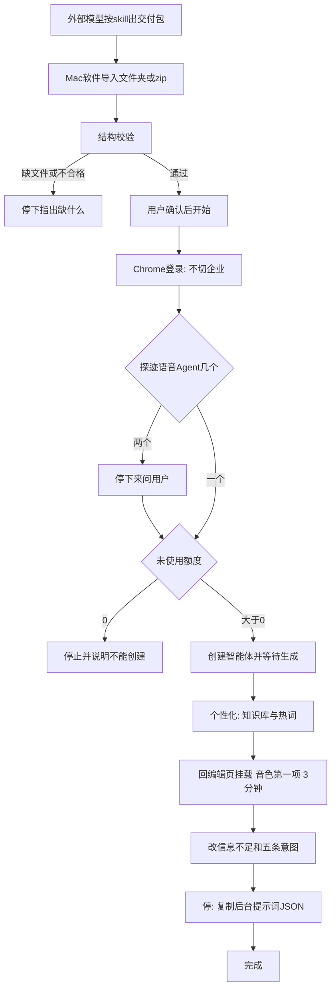

# 语音 Agent 配置 · 软件流程

| 项目 | 内容 |
|---|---|
| 状态 | Mac 3.0：导入→核对→上传已接通。上探迹需用真实账号再过一遍页面 |
| 软件版本 | 3.0 |
| 日期 | 2026-10-26 |
| 范围 | **只做 Mac 原生版**（`mac/Sources`）。Windows、轻量版都不做。 |
| 样例 | 只用「示例品牌 / 示例产品」，不写真实客户 |

现有「新建话术 / 修改已有话术」（导入 → 体检 → 意向 → 上传）保持不动。本文件只描述以后要加的「配置语音 Agent」这条流程。

---

## 1. 一句话

外部大模型按 skill 生成交付包；**Mac 软件只导入、校验、上传到探迹**。这条流程不跑本地 4B。登录后**不切换**「客户成功企业」。

## 2. 分工

| 谁 | 做什么 |
|---|---|
| 外部模型 + skill | 确认卡、智能体配置、知识库 md、热词、意图、后台提示词 JSON |
| Mac 软件 | 导入交付包 → 结构校验 → 用户确认 → Chrome 按页上传 |
| 人不在软件里重做 | a/b/c、钩子确认、写知识库/意图口径 |

话术上传里的体检、补问法、意向建议仍可用本地模型。**配置语音 Agent 时不加载、不调用** `src/main/local-llm.ts`，减轻本机内存压力。

确认卡在 skill 侧完成，包内应有 `确认卡.md`。软件不重问「详尽/简洁、问句结尾、语气词」，只检查包里有没有、字段齐不齐。

## 3. 为什么不让本地模型生成

标准版内置 Qwen3-4B-Instruct Q4，上下文 2k/4k，现网只稳在封闭任务（意向六选一、补问法、错字）。知识库若「没写的也补上」会幻觉；意图改写和异议话术更容易丢边界、串成套话。分步 + JSON schema 只能保证**结构能过校验**，不能免审。

因此材料生成全部放在外部模型。软件不承担写作。

## 4. Skill 先验收再当导入契约

规则已经齐（字段限制、29 条内置、五条必改、异议四 key、热词字数、确认卡），外用包里有 `validate_output.py`。**还没有用虚构资料空跑出完整交付包**，不能当已经稳定。

常见翻车：对方 AI 只读了 `SKILL.md`、五条意图改飘；把「可以」当成确认；JSON 漏资格问或四套异议；校验过了但口径仍是「系统一年多少钱」。校验只查结构，不查有没有编。

软件写代码之前：用**虚构或脱敏**资料按外用 skill 跑一轮 → 过结构校验 → 人看知识库、五条意图、异议 → 通过后再把目录格式当 Mac 导入契约。真实客户资料不要写回 skill。

## 5. 在 Mac 上长什么样

做在现有 **Mac 原生「探迹话术上传助手」**里，入口与「新建话术 / 修改已有话术」分开（侧栏第三条，或顶部产品切换）。Windows（`src/renderer`）和轻量版本轮都不做。

分开的原因：登录策略相反。话术上传会强制切到「客户成功企业」（`src/main/automation.ts` 的 `ensureCompany`）。语音 Agent **禁止切换**，停在用户当前企业。

Chrome 登录态可以共用，但企业切换必须分叉，不能复用现在的 `ensureCompany`。

## 6. 用户流程



Mac 内步骤：

1. 导入 `voice-agent/<企业对外名称>/` 或 zip。软件里可先「下载示例包」（虚构「示例品牌」，在 [resources/语音Agent示例交付包.zip](../resources/语音Agent示例交付包.zip)）。真实客户包由外部 skill 生成，不要写回仓库。
2. 结构校验：文件是否齐、热词字数、意图五条、异议四 key、资格问 2～3 条。
3. 用户确认后打开 Chrome 上传。
4. 后台提示词不自动填，软件提供复制。

### 交付包（导入契约）

```text
voice-agent/<企业对外名称>/
  确认卡.md
  00-智能体配置.md
  01-知识库/*.md
  02-热词.txt
  03-意图.json
  03-意图.md
  04-后台提示词.json
```

定位探迹页面用可见文案，不用打包后的哈希 class。

## 7. 上探迹：阶段与停顿

| 阶段 | 行为 | 停顿 |
|---|---|---|
| launching / login | 打开探迹，人在 Chrome 登录 | 与现网相同：回到软件点「已登录，继续」 |
| 企业 | **不调用** `ensureCompany` | 当前是哪家就哪家 |
| 入口 | 找「探迹语音Agent」，然后直接打开 `https://call-agent.tungee.com/agents`（侧栏 menuitem「智能体」）。不要点工作台输入框旁的「@ 智能体」按钮 | **出现两个入口卡片就停下来问**。默认落地是 `/workspace`，创建入口只在 `/agents` |
| 额度 | 读「未使用」后面的数字 | **等于 0 且列表里没有同名智能体则停止，不能新建**。列表已有同名则跳过创建，继续编辑配置 |
| 创建 | 按核对页上的名称、对外名称、自称、角色、场景、目标填（可改 skill 原文） | 等「智能体生成中，请勿关闭页面」约 1–2 分钟 |
| 个性化 | 知识库：`新建` → `文件` → 弹层「添加文件」→ 上传 md → `确 定`（无障碍名中间有空格）；关弹层后再点 `热词 27` 这类带数量的菜单。热词：`plus 添加文件` → 抽屉「添加热词文件」 | 热词一行一个、每个少于 10 个字；不要用「【分类】」当一行。弹层没关会挡住「热词」，报 E-WEB-001 |
| 编辑页 | 智能体列表搜名称 → `更多操作` → `编辑`。音色是 ComboBox 第一项（不写死名字）；`最大通话时长` 点按钮 `3 分钟`；知识库 `plus 添加` → 弹层「选择知识库」里搜文件名、勾选、`确 定`（只点弹层内，不要点开场白里的「产品」）；热词 `plus 添加` 点已有文件名（不要点「创建热词」）；最后点 `提 交` | — |
| 意图 | `搜索意图名称` → 行内 `编辑` → 抽屉「编辑企业意图」：`意图分类`、`意图描述`、`正面示例`、`反面示例` → `保存`。搜不到「信息不足」则跳过 | 五条必改：询问价格、已有供应商、接受资料、有采购计划、安排演示 |
| 后台提示词 | 软件复制 `04-后台提示词.json` | **停在粘贴**。后台不在语音 Agent 页里，第一版不自动填后台 |

不上传录音。开场白不加录音告知。没有钩子则开场白用前端已经配好的，软件不另写。

## 8. 和话术上传的差别

| | 话术上传（已有） | 语音 Agent（本流程） |
|---|---|---|
| 平台 | Mac 已有；Windows 也有 | **只做 Mac** |
| 材料从哪来 | Excel + 录音，本机检查 | 外部 skill 交付包 |
| 本地 4B | 体检 / 意向可用 | **不调用** |
| 登录后企业 | 切到客户成功企业 | **不切** |
| 探迹入口 | 我的话术 | 「探迹语音Agent」 |
| 录音 | 要上传 | 不要 |

## 9. 非目标

- 不把真实客户写进文档或 skill 样例
- 不删除探迹里的任何内容
- 语音 Agent 流程不加载本地大模型
- 软件内不重做确认卡，不生成知识库 / 热词 / 意图 / 提示词
- 第一版不自动打开或填写探迹「后台提示词」页
- **Windows 不做**（含 `src/renderer` 的话术助手 Windows 壳）
- **轻量版不做**（不为无本地模型的发行版单独接这条流程）

## 10. 代码入口

- 入口与侧栏：[mac/Sources/TungeeUploader/ContentView.swift](../mac/Sources/TungeeUploader/ContentView.swift)、[TungeeUploaderApp.swift](../mac/Sources/TungeeUploader/TungeeUploaderApp.swift)、[AppModel.swift](../mac/Sources/TungeeUploader/AppModel.swift)、[VoiceAgentViews.swift](../mac/Sources/TungeeUploader/VoiceAgentViews.swift)
- Mac 与 Node 的通道：[mac/Sources/TungeeUploader/Sidecar.swift](../mac/Sources/TungeeUploader/Sidecar.swift)
- 校验：[src/main/voice-agent-pack.ts](../src/main/voice-agent-pack.ts)（对齐 skill `validate_output.py`）
- 上传：[src/main/voice-agent-automation.ts](../src/main/voice-agent-automation.ts)，登录/会话与话术共用 Chrome 配置目录，**不调用** `ensureCompany`，不碰 `local-llm.ts`
- 进度阶段：[src/shared/types.ts](../src/shared/types.ts) 增加额度 / 双入口 / 等待生成 / 粘贴提示词等（Mac `Models.swift` 同步）
